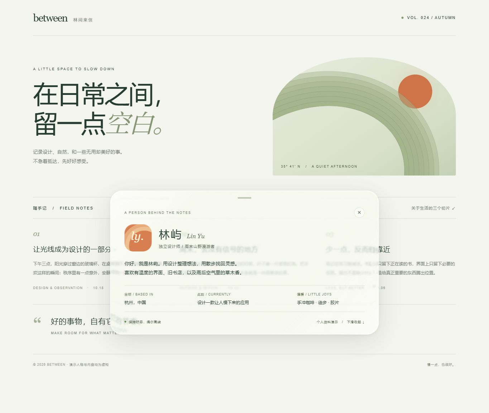
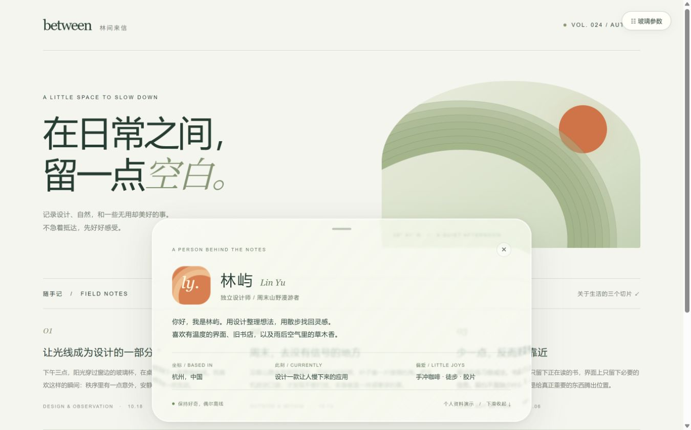
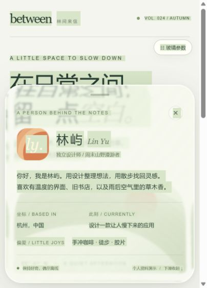
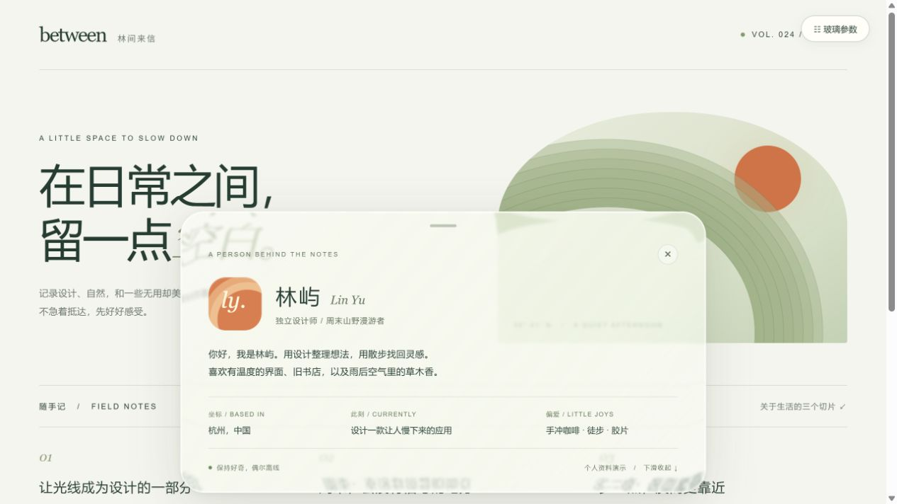

# liquidglass1021

浅色、双层面板的本地液态玻璃演示。首页可以切换最早初版与当前终版；两种模式都支持底部上拉或点击展开、下滑或点击关闭。

## 运行

用 Chrome / Edge 打开 `index.html`，无需安装依赖或联网。也可以在仓库目录运行：

```sh
python -m http.server 8080
```

然后打开 `http://localhost:8080/`。

## 两个模式

| 模式 | 入口 | 实现 |
| --- | --- | --- |
| 初版 · SVG | `modes/initial.html` | 首次交付的固定参数界面，无调参框；SVG 背景位移折射 |
| 终版 · 实时 | `modes/final.html` | 实际页面 SVG 折射与静态外观分层；包含调参、参数导入导出；快照缓存只作为实验选项 |

模式可通过首页按钮或 `?mode=initial` / `?mode=final` 选择。独立打开模式页面可获得完整视口。

此前本地项目没有 Git 历史，初版根据首次交付实现与后续增量修改记录还原，不冒充当时的原始 Git 提交。终版是当前交付文件的直接副本。浏览器中保存的私人外观参数不在仓库内：如要迁移，请先在原页面导出参数 JSON，再在终版导入。

## 性能与工程记录

- `performance-lab.html`：可重复的受控滚动、缓存复用、GPU timer 和故障回退测试；需要时可导入同一套参数。
- [工程日志](docs/工程日志.txt)：各阶段工作、有效/作废结果、路线取舍和验证限制。
- [实时折射优化审查](docs/实时折射优化方案.txt)：保留动态背景的候选路线、第一方资料、分区细节及验收条件；几何估算不等于性能测量。
- [实时优化执行日志](docs/实时优化执行日志.txt)：实际执行、失败路线、采用的外观分层方案与验收边界。
- [实时优化原始测量](docs/实时优化测量.json)：各轮完整调度数据；不是呈现FPS。
- `live-lab.html`：原版与各候选的交错滚动实验，可复现失败路线。使用独立参数存储，Alt+L显示/隐藏控制区。
- `live-acceptance.html`：真实input选区、CSS动画、Canvas、内容修改和资源释放验收，也使用独立参数存储。
- [原始测量结果](docs/测量结果.json)：包括测试视口和像素比。
- [完整说明](docs/说明.txt)：交互、参数备份与测量边界。说明中的 `index.html` 指原交付入口，对应本仓库 `modes/final.html`；`baseline-svg.html` 指调参后、优化前的内部对照，不等同最早初版。

滚动时不关闭折射。默认实时路径保留底板文字选中与动态变化；不会启动 WebGL 或生成页面快照。实验缓存无法反映浏览器文字选择、悬停及动画等绘制状态，不适合作为通用页面的默认渲染器。旧版自动缓存偏好不再沿用，外观参数不变。rAF 频率与 GPU 绘制耗时不能证明屏幕实际呈现稳定 120 FPS；压力下的合成线程同步尚无显示级轨迹验证。详细限制见日志。

## 预览

初版：



终版（验收默认参数；历史缓存版截图）：



## 来源

基于 [xiaofangstudio/liquid-glass-web](https://github.com/xiaofangstudio/liquid-glass-web) 与 [Shu Ding 的 liquid-glass](https://github.com/shuding/liquid-glass) 的 SVG 位移思路。终版 WebGL2 缓存渲染不依赖外部库。人物和内容均为虚构。

第三方声明见 [THIRD-PARTY-NOTICES.txt](THIRD-PARTY-NOTICES.txt)。未配置 GitHub Pages 或其他公开部署。

实时修复验收：底板选中高亮参与折射。



当前实时分层交付版（测试默认参数）：



本轮分离静态外观与真实背景滤镜，并修复实验缓存的资源释放。受控调度长尾总体改善，但也出现双方同时变慢的轮次，全部数据保留。未取得呈现级轨迹，不能宣称稳定120FPS。
